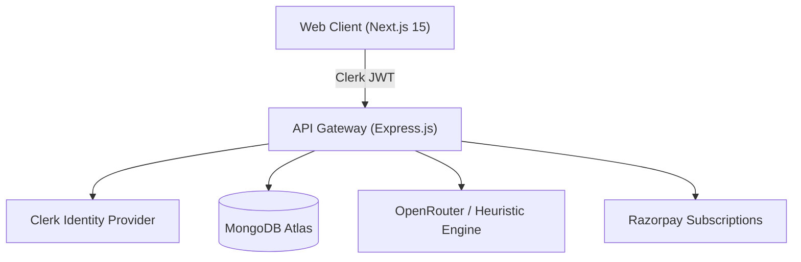

# CareerPulse AI — Architectural Documentation

## 1. System Overview

CareerPulse AI is an enterprise full-stack platform designed to integrate job aggregation, deterministic ATS analysis, transparent Indian tech compensation analytics, and 1:1 engineering mentorship.



---

## 2. Monorepo Organization

```
career-pulse-ai/
├── apps/
│   ├── web/               # Next.js 15 App Router (TypeScript, Tailwind, Radix UI, Recharts)
│   └── api/               # Express.js REST API (TypeScript, Mongoose, Zod, Clerk)
├── packages/
│   ├── shared/            # Domain Types, Zod Schemas, Job Normalizer, Constants
│   └── ui/                # Shared Design Tokens & Utility helpers
├── scripts/
│   └── seed-database.ts   # Database seeder for jobs, companies, reviews, salaries, mentors
├── docs/                  # Architectural diagrams & API documentation
├── .env.example
├── pnpm-workspace.yaml
└── README.md
```

---

## 3. Provider-Adapter Pattern for Job Discovery

All external job feeds (JSearch, Adzuna, Remotive, Greenhouse/Lever) implement the provider-adapter interface normalizing into one canonical internal `Job` model:

- `source`: Provider identifier (`direct`, `jsearch`, `adzuna`, `remotive`, `greenhouse`)
- `sourceJobId`: Canonical provider job id
- `title`, `company`, `companySlug`, `companyLogo`
- `salaryMin`, `salaryMax`, `salaryCurrency` (standardized to INR LPA or international format)
- `publishedDate`: Strict ISO 8601 publication timestamp (never confused with crawler ingestion time)
- `deduplicateJobs()`: Composite title + company + location normalization.

---

## 4. Security & Role Authorization

- **Clerk JWT Verification**: Validated on the Express backend (`requireAuth` middleware).
- **Role-Based Access Control**:
  - `candidate`: Search jobs, track applications, build resumes, book mentors.
  - `recruiter`: Create & publish native openings, review applicant pool, screen statuses.
  - `mentor`: Manage availability, view 1:1 bookings, video room links.
  - `admin`: Full moderation, audit logs, and override capabilities.
- **Backend Entitlement Enforcement**: All Pro features (unlimited XYZ rewrites, advanced salary percentiles) are secured at the API controller layer, never client-side only.
- **Cryptographic Payment Verification**: Razorpay HMAC SHA-256 signatures verified on payment capture before activating subscriptions.
